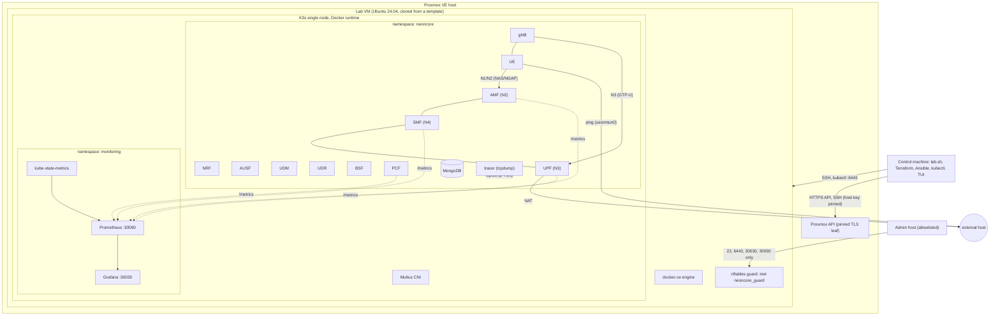

# NeonCore 5G


A 5G standalone (SA) testbed: Open5GS core and UERANSIM gNB/UE on single-node K3s, inside a
Proxmox VM, with Prometheus, Grafana and packet tracing. Next, planned: labeled faults and AI that
finds them. The work follows a staged roadmap (stages W0 to 12, status per stage in the
[roadmap](docs/roadmap/neoncore-roadmap.pdf)). Built with AI agents under the owner's direction.

```bash
scripts/labenv infra/lab.sh up
```

## Quick start

`lab.sh up` builds or converges the whole lab from zero: Terraform clones the VM from an
owner-prepared template, Ansible configures it (kernel modules, Docker, LAN guard, K3s, the UPF
image), then the workloads are deployed and verified. Lab settings and the Proxmox API token
come from the gitignored `.env.lab` through `scripts/labenv`; they are never printed or
committed. Setup of the Proxmox side (token, template, variable names) is in
[`docs/lab-proxmox.md`](docs/lab-proxmox.md).

| Command | What it does |
|---|---|
| `scripts/labenv infra/lab.sh up` | Build or converge the whole lab |
| `scripts/labenv infra/lab.sh deploy` | Workloads only: Multus, phase2-4 manifests, recovery order UPF, SMF, UE |
| `scripts/labenv infra/lab.sh verify` | Read-only health check (pods, UPF counters, UE ping, tracer) |
| `scripts/labenv infra/lab.sh status` | Pin check, VM state, node and pod summary |
| `./start.sh`, `./stop.sh` | Power the VM on or off, scaling workloads and recovering in order |
| `scripts/labenv infra/lab.sh snapshot <name>` | Create a snapshot (`l0-base`, `golden-l0`, `pre-*`) |

There is deliberately no destroy, rollback or snapshot-delete subcommand; those are owner-only
steps in the Proxmox console. The mutating subcommands run an approval check first (see
[`docs/agent-gate.md`](docs/agent-gate.md)).

## Architecture



**Layers, bottom to top:**

1. **Proxmox VE** hosts one VM. Terraform (bpg/proxmox provider, TLS leaf certificate pinned,
   no insecure fallback) clones it from a template; Ansible configures it. A small nftables
   table on the VM drops new inbound connections except from the allowlisted admin address.
2. **Docker and K3s.** A native `docker-ce` engine, and a single-node K3s cluster that uses it as
   the container runtime (`--docker`), with Traefik and ServiceLB disabled.
3. **Multus CNI** rides alongside K3s's default Flannel network for secondary interfaces
   (macvlan/ipvlan). The current NF topology does not need them; all NFs talk over the default
   pod network.
4. **`neoncore` namespace**, the 5G core itself:
   - **NRF** (discovery hub) then **AUSF** (5G-AKA) then **UDM/UDR** (subscriber data in
     **MongoDB**) then **PCF** (policy; needs **BSF** for `nbsf-management`) then **AMF**
     (N1/N2) then **SMF** (N4/PFCP) then **UPF** (N3/GTP-U and NAT). The UPF is a custom build
     of Open5GS v2.8.0 that adds the N3 GTP packet-count metrics (see
     [`DEVLOG.md`](DEVLOG.md)).
   - **gNB** and **UE** (UERANSIM) simulate the radio side. The UE gets a PDU session and a
     `uesimtun0` interface.
   - **tracer** captures packets from all of the above (see [Network tracing](#network-tracing)).
5. **`monitoring` namespace**: Prometheus scrapes native Open5GS metrics (AMF, SMF, UPF, PCF
   only) plus pod health from kube-state-metrics; Grafana visualizes both.
6. **The TUI** (`phase5/`, a Textual app) is a `kubectl` wrapper: deploy, teardown, pod health,
   UE ping, trace summaries and scenario runs from one terminal.

## Access

Everything is reachable only from the allowlisted admin host (`LAB_ADMIN_CIDR` in the lab env
file); the guard on the VM drops other new inbound connections.

| What | Where |
|---|---|
| TUI | On the control machine: `bash phase5/run.sh` (uses the kubeconfig that `lab.sh up` writes) |
| Grafana | `http://<vm-address>:30030`, dashboard **NeonCore 5G** |
| Prometheus | `http://<vm-address>:30090` |
| SSH, Kubernetes API | `<vm-address>`, ports 22 and 6443 |

`<vm-address>` is the VM's address, set in the lab env file and not recorded in this repository.

## Using the TUI

```bash
bash phase5/run.sh
```

The first run builds a `.venv` and installs [Textual](https://textual.textualize.io/); later runs
reuse it.

| Key | Action |
|---|---|
| `d` | Deploy the full stack (phase2, phase3, phase4 manifests, in order); asks first |
| `t` | Teardown (`kubectl delete namespace neoncore monitoring`); asks first, **destroys the packet-trace PVC too** |
| `p` | UE connection test: `ping -I uesimtun0` inside the live UE pod |
| `l` | Latest network traces: recent PCAPs from the tracer pod and a summary of the newest |
| `s` | Run a 5G signaling scenario (see below); asks for MSISDN and policy parameters |
| `c` | Start or stop a manual packet capture (toggle) |
| `r` | Force a pod-table refresh (it also refreshes every 4 s) |
| `q` | Quit |

"Deploy/teardown" here means the NeonCore workload (`neoncore` and `monitoring` namespaces), not
K3s or the VM; those belong to `lab.sh`.

## Scenario automation

`phase6/` drives real 5G signaling procedures against the live core, with a fresh, uniquely named
pcap per run. Each uses a short-lived UE pod (never the long-lived `ue` Deployment's pod) and
cleans up afterwards:

| Scenario | What it proves | Trigger |
|---|---|---|
| `initial-registration` | A provisioned IMSI attaches successfully | none |
| `registration-reject` | An unprovisioned IMSI is rejected by the network | IMSI is deliberately never provisioned |
| `deregistration` | UE-initiated deregistration makes the SMF release the PDU session | `nr-cli <imsi> --exec "deregister normal"` after attach |

From the TUI press `s`, enter a 10-digit MSISDN (IMSI = `99970<msisdn>`) and optional policy
overrides (5QI, ARP priority, AMBR), then pick a scenario. Directly:

```bash
python3 -m phase6.cli --scenario initial-registration --msisdn 0000000100
python3 -m phase6.tests.run_scenarios      # the full integration suite
```

Each run's pcap lands in `traces/scenario-runs/` (gitignored). Handover and Tracking Area Update
are not implemented: UERANSIM does not implement the underlying procedures (see the "Phase 7"
section of [`DEVLOG.md`](DEVLOG.md), which describes the code in `phase6/`).

## Monitoring

- **Grafana** (port 30030): pre-provisioned dashboard **NeonCore 5G** with pod health and
  restarts, AMF registrations, SMF PDU session establishment, UPF sessions and N3 GTP-U packet
  rate, PCF policy associations and per-NF memory. Anonymous Admin access is on; see
  [Hardening](#hardening-for-anything-beyond-a-single-admin-lab).
- **Prometheus** (port 30090): raw metrics and PromQL.

Only AMF, SMF, UPF and PCF export native Open5GS metrics; NRF, AUSF, UDM, UDR and BSF do not
implement the metrics HTTP server in this build (see the Phase 3 section of
[`DEVLOG.md`](DEVLOG.md)).

## Network tracing

A single `tracer` pod runs `tcpdump -i any` with `hostNetwork: true`, capturing N2 (SCTP/NGAP),
N4 (PFCP), N3 (GTP-U), SBI (HTTP/2) and ICMP. Files rotate, are gzipped, and old ones are deleted
automatically; they live on a PersistentVolume, so they survive pod restarts.

```bash
TRACER_POD=$(kubectl -n neoncore get pods -l app=tracer -o jsonpath='{.items[0].metadata.name}')
kubectl -n neoncore exec "$TRACER_POD" -- ls -la /pcaps
kubectl -n neoncore cp "neoncore/$TRACER_POD:/pcaps/<filename>.pcap.gz" ./capture.pcap.gz
```

Press `l` in the TUI for a summary. The manual capture (`c`) starts a second, independent
`tcpdump` on the same pod and copies the result to `traces/manual/` when stopped.

`lab.sh deploy`, `verify` and `start` check that the newest pcap is growing and restart only the
tracer pod if it is not (a stalled `tcpdump` was seen after a UE restart; see Stage L0 in
[`DEVLOG.md`](DEVLOG.md)).

## Project structure

```
neoncore-5g/
├── README.md, DEVLOG.md   this file; the engineering log (bugs, causes, fixes)
├── start.sh, stop.sh      VM power and workload wrappers over infra/lab.sh
├── infra/                 lab.sh, Terraform (VM), Ansible (guest), lib/ helpers, tests/
├── phase0/                docker-compose validation (Open5GS + UERANSIM, no K8s); NF configs
├── phase1/                Multus HelmChart (and a test NAD that is never applied)
├── phase2/                the 5G core + RAN manifests; custom UPF build recipe
├── phase3/, phase4/       Prometheus/Grafana/kube-state-metrics; the packet tracer
├── phase5/                the Textual TUI
├── phase6/                signaling-scenario automation and tests (DEVLOG "Phase 7")
├── evals/                 evaluator scripts and their tests
├── docs/                  lab runbook, agent gate, roadmap PDF
├── project/               stage plans, notes, reports, status (the agent workflow)
└── scripts/               labenv, approve (owner only), gate tests
```

## Roadmap

The full plan is in [`docs/roadmap/neoncore-roadmap.pdf`](docs/roadmap/neoncore-roadmap.pdf). New
work is called a Stage; each stage has a plan, an owner approval and a closing report.

| Stage | Scope | Status |
|---|---|---|
| W0 | Agent workflow and approval gate | Closed |
| L0 | Migrate to Proxmox, retire the old host, repo polish | Closed 2026-11-11 (old-host retirement, T15a, owner-only, not done) |
| 7 | Labeled fault injection and dataset generator | Planned |
| 8 | Call-flow extractor and first LLM troubleshooter | Planned |
| 9 | Telco-RAG over 3GPP specs, local open-weight LLM | Planned |
| 10 | MCP server and diagnosing agent | Planned |
| 9B | Local vs API RAG comparison | Planned |
| 11 | KPI anomaly detection (`nwdaf-lite`) and CI eval gate | Planned |
| 12 | Self-hosted vs API model comparison, red-team, reference architecture | Planned |

## History

NeonCore 5G started as a single-node K3s cluster inside WSL2 on a Windows PC, built phase by phase
from bare-metal validation up to the TUI and scenario automation. That VM has since been deleted and
the lab now runs on Proxmox, so no WSL2-era baseline exists to compare against. The engineering
log, including the WSL2 clock-drift analysis, is in [`DEVLOG.md`](DEVLOG.md).

## Troubleshooting

### Multus

**Multus pod stuck `CrashLoopBackOff` or `ContainerCreating`.** Check
`kubectl -n kube-system logs -l app=rke2-multus`. K3s does not use the standard `/opt/cni/bin` and
`/etc/cni/net.d` paths; it uses `/var/lib/rancher/k3s/data/cni/` and
`/var/lib/rancher/k3s/agent/etc/cni/net.d`. `phase1/multus-helmchart.yaml` sets these explicitly.

**A pod with a `NetworkAttachmentDefinition` annotation gets no secondary interface.** Check the
annotation name (and namespace), `kubectl describe pod`, and the
`k8s.v1.cni.cncf.io/network-status` annotation. The `master` interface named in a macvlan NAD
must exist on the node, and the `macvlan`/`ipvlan` modules must be loaded.

### Core and networking

**gNB never completes NG Setup / connection refused on port 38412.** The SCTP kernel module is not
loaded. Check `lsmod | grep sctp` on the VM; `lab.sh up` converges the kernel role again.

**UPF `CrashLoopBackOff` with `ioctl(TUNSETIFF): Operation not permitted`.** The UPF needs
`runAsUser: 0`, `NET_ADMIN` and a `hostPath` mount of `/dev/net/tun` together; missing either
reproduces the error (see Phase 0 and Phase 2 in [`DEVLOG.md`](DEVLOG.md)).

**SCTP Services unreachable through a ClusterIP.** kube-proxy's SCTP proxying through a normal
ClusterIP is unreliable, so every Service in `phase2/manifests/` is headless
(`clusterIP: None`). Make any new SCTP Service headless too.

**After a UPF restart the UE has no data path.** The SMF caches the UPF address. Restart in the
order UPF, SMF, UE (`lab.sh deploy` and `start` do this).

**`kubectl` hangs or the cluster is unreachable.** Run `scripts/labenv infra/lab.sh status`, then
check `systemctl is-active k3s` on the VM. If the Proxmox API itself is slow, see the NAS note in
[`docs/lab-proxmox.md`](docs/lab-proxmox.md).

### Hardening for anything beyond a single-admin lab

Several defaults prioritize convenience and should not ship as-is where there are real users:
Grafana anonymous Admin access and a hardcoded admin password
(`phase3/manifests/06-grafana.yaml`); a `privileged` tracer with `hostNetwork`; the UPF running as
root with `NET_ADMIN`; MongoDB without authentication. The VM's nftables guard limits exposure to
the allowlisted admin address, but it does not fix those defaults.

## Credits

- [Open5GS](https://open5gs.org/), the 5G core implementation.
- [UERANSIM](https://github.com/aligungr/UERANSIM), the gNB/UE simulator.
- [Gradiant](https://github.com/Gradiant/5g-images), the `open5gs` and `ueransim` images this
  project builds on, and the `rke2-multus` Helm chart used for Multus on K3s.
- [Textual](https://textual.textualize.io/), the TUI framework.

## License

MIT, see [LICENSE](LICENSE).
