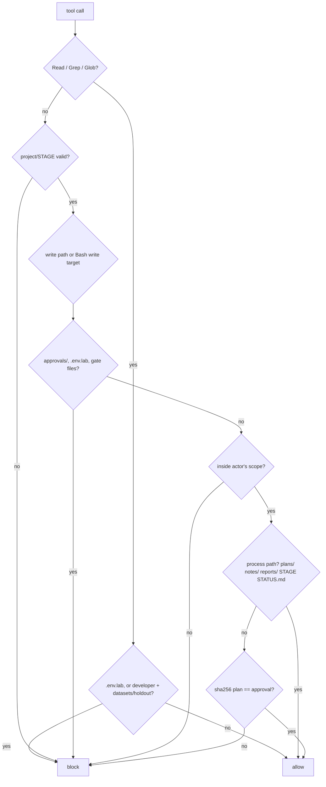

# The agent approval gate

NeonCore is built by Claude Code subagents. This page explains the controls that keep them
inside an approved plan, and **what those controls cannot do**.

## Pieces

| Piece | Role |
|---|---|
| `project/STAGE` | The current stage (`W0 L0 7 8 9 10 9B 11 12`) |
| `project/plans/<stage>.md` | The plan for that stage |
| `scripts/approve.sh <stage> plan\|close` | Run by the owner in their own terminal. Refuses without a TTY or inside a Claude Code shell, shows the title and SHA-256, requires typing `APPROVE`, writes `project/approvals/<stage>.<kind>.sha256` |
| `.claude/hooks/gate.py` | `PreToolUse` hook on `Edit\|Write\|NotebookEdit\|Bash\|Read\|Grep\|Glob`. Exit 2 blocks the tool call |
| `.claude/settings.json` | Permission deny/ask rules; denies edits to the gate's own files |

## What the hook enforces



- **Approval binding.** A product write passes only if `sha256(project/plans/<STAGE>.md)` equals
  the hash in `project/approvals/<STAGE>.plan.sha256`. Editing the plan voids the approval.
- **Scopes.** The actor is the hook input's `agent_type` (`lead` when absent). Each agent writes
  only inside its own folders (see `project/WORKFLOW.md`). Agent types the gate doesn't know are
  read-only. The lead has no product scope after W0.
- **Lab changes** (`terraform apply`, `ansible-playbook`, `qm`/`pct` writes, `pvesh` writes, Proxmox
  API writes, `helm` changes, `kubectl apply -f` and cluster-level `kubectl`, `ssh`/`scp`) run only
  as `lab-ops`, and only with an approved plan.
- **Project CLI** operations in the `neoncore`/`monitoring` namespaces (delete a pod, scale,
  `python3 -m phase6.cli`) are allowed for any agent once the stage plan is approved. Read-only
  `kubectl get/describe/logs` is always allowed.
- **Destructive and publishing** commands are blocked for everyone, so the owner runs them:
  force push, `git branch -D`, `reset --hard`, `rebase`, `clean -f`, `kubectl delete namespace`,
  recursive `rm` outside the scratchpad, `terraform destroy`, `qm/pct destroy`, `docker push`,
  `gh` publishing commands.
- **Fail closed.** Bad JSON, a missing field, an unknown tool, or a missing or unknown
  `project/STAGE` blocks. (Read tools still run without a valid stage, so a broken STAGE file
  can be diagnosed.)

## Limits (read this)

**The Bash rules parse command text. They catch mistakes, not a determined adversary.**

- Aliases, shell functions, `eval`, base64-encoded commands, variables that expand to paths, and
  `bash -c` strings are not fully parsed. Unresolvable write targets are treated as writes to the
  current directory, which catches some of these.
- Anything a program does internally is invisible: a Python script that opens a file for
  writing, `make`, `npm` scripts, `tar -x`, and the TUI's own `kubectl` subprocess calls.
- Command text is checked, not the effect. A false positive (for example a `>` inside a quoted
  string) blocks the call; the agent must rephrase.
- Mentioning `project/approvals`, `approve.sh` or `.env.lab` anywhere in a Bash command blocks it,
  including in a commit message. That's deliberate bluntness.
- Agents can still read the approval files (only writes are blocked). That's fine: reading them
  grants nothing.
- Approvals are meant to be written only by a human at a TTY, the hash ties them to exact plan
  bytes, and `settings.json` denies edits to the gate itself. Changing the gate takes the owner's hand.
- **Known weakness (S-I3, accepted risk at L0 close):** the TTY and Claude Code marker checks can be
  faked by any process running as the same user, so an approval file is not proof the owner approved.
  Approvals are not signed yet. Fix: signed approvals plus a separate OS user for agents (W0
  amendment), due before the Stage 7 plan is approved.
- `bypassPermissions` mode is disabled in project settings.
- `lab.sh`, `labenv`, `start.sh` and `stop.sh` run lab changes inside subprocesses the gate cannot see. The controls that apply are the owner-added gate patterns (D16), with the evaluator `evals/l0` allowance, plus `lab.sh`'s own approval-hash check and plan guard.

## Testing

```bash
python3 scripts/tests/test_gate.py -v
```
Feeds sample hook JSON to the gate against a throwaway fixture project. `approve.sh` itself is
tested by the owner (it refuses to run under Claude Code).
