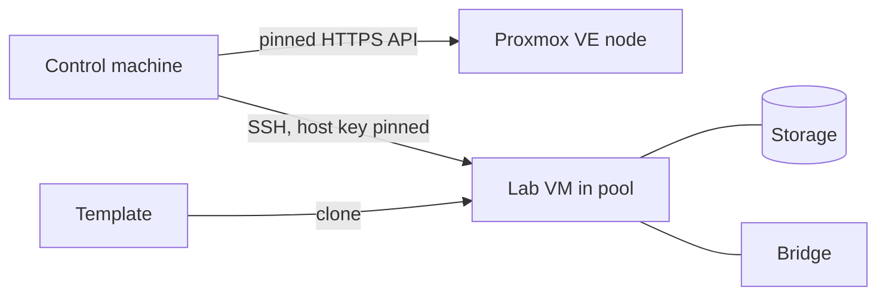

# Proxmox lab runbook

How the NeonCore lab is built on Proxmox VE and how to operate it. Sources: `infra/`
(`lab.sh`, Terraform, Ansible) and the Stage L0 build notes in
[`project/notes/L0.md`](../project/notes/L0.md). No site values (addresses, host names, node,
storage, bridge, pool or VMID) are recorded in this repository; they live in the gitignored
`.env.lab` and are written below as `<placeholders>`.

Steps marked **(owner)** are done by the owner in the Proxmox console or a terminal. Agents do not
run them, and `lab.sh` has no subcommand for them.

## Layout



## One-time setup on Proxmox (owner)

1. A resource pool `<pool>`.
2. A cloud-init template (decision D5b) in that pool: Ubuntu 24.04, `qemu-guest-agent` is
   optional (Ansible installs it later).
3. A user, a role and a **privilege-separated API token**, with the ACL set on the pool path, the
   storage path and the bridge's SDN path. Never on `/`.
4. An SSH key pair for the VM (private key stays on the control machine).

### Token privileges

Role on the pool, exactly this set (the build recorded "missing: none, extra: none" against it in
`project/notes/L0.md`):

| Group | Privileges |
|---|---|
| VM | `VM.Allocate`, `VM.Audit`, `VM.Clone`, `VM.PowerMgmt`, `VM.Snapshot`, `VM.Snapshot.Rollback` |
| VM config | `VM.Config.CDROM`, `VM.Config.CPU`, `VM.Config.Cloudinit`, `VM.Config.Disk`, `VM.Config.HWType`, `VM.Config.Memory`, `VM.Config.Network`, `VM.Config.Options` |
| Guest agent (PVE 9) | `VM.GuestAgent.Audit`, `VM.GuestAgent.FileRead` |
| Storage and network | `Datastore.AllocateSpace`, `Datastore.Audit`, `SDN.Use` on the bridge |

Notes:

- **No `Pool.Audit`.** The token deliberately cannot read pool membership, so Terraform's
  `pool_id` always reads as unset after a refresh. `main.tf` therefore has
  `lifecycle { ignore_changes = [pool_id] }`; pool membership is checked by the owner on the host
  (`pvesh get /pools/<pool>`). See the DEVLOG Stage L0 entry.
- **No `Sys.Audit`.** The token cannot read node status, so CPU flags (AVX/AVX2 for the
  `x86-64-v3` CPU model) cannot be verified through the API; the owner checks `/proc/cpuinfo`
  on the host.
- On PVE 8 the guest-agent file read needs `VM.Monitor`, which includes guest-exec (root in the
  VM). This lab runs PVE 9.
- `VM.Allocate` inside the pool also permits destroying VMs. "No destroy subcommand" is a
  convention there, not an ACL limit.

## `.env.lab` variable names

Names only. Values are the owner's and are never printed, committed or put in chat. The file is
loaded only through `scripts/labenv <command>`.

| Name | Meaning |
|---|---|
| `PVE_ENDPOINT` | Proxmox API URL |
| `PVE_API_TOKEN` | API token (id and secret) |
| `PVE_TLS_FINGERPRINT` | SHA-256 of the API's TLS leaf certificate (pinned; there is no insecure fallback) |
| `TF_VAR_node_name` | `<node>` |
| `TF_VAR_vm_id` | `<vmid>` |
| `TF_VAR_pool_id` | `<pool>` |
| `TF_VAR_datastore_id` | `<storage>` for the VM disk |
| `TF_VAR_template_vm_id` | `<template-vmid>` |
| `TF_VAR_bridge` | `<bridge>` |
| `TF_VAR_vlan_id` | optional VLAN tag |
| `TF_VAR_ipv4_cidr`, `TF_VAR_gateway`, `TF_VAR_dns_servers` | the VM's static network settings |
| `TF_VAR_vm_user` | the VM login user |
| `LAB_SSH_KEY_FILE`, `LAB_SSH_PUBKEY_FILE` | paths of the SSH key pair |
| `LAB_ADMIN_CIDR` | the one admin address (`/32`) allowed through the VM's nftables guard |

`lab.sh` refuses to run if `PROXMOX_VE_INSECURE`, `PROXMOX_VE_SSH_*`, `TF_LOG` or
`TF_LOG_PROVIDER` is set, even empty.

`TF_VAR_dns_servers` may be given as a plain string or a bracket list; Terraform parses both.

## Rebuild from zero

Prerequisites on the control machine: `terraform`, `ansible-playbook`, `kubectl`, `jq`,
`openssl`, `ssh`. Then:

```bash
scripts/labenv infra/lab.sh up
```

`up` runs, in order: pin check of the API certificate; `terraform init` and `plan` through the
plan guard (refuses any delete or replace, wrong pool or non-allowlisted resource types); apply
of the saved plan; VM power on; SSH host key pin; `cloud-init status --wait` (exit 0 or 2 both
accepted); Ansible `site.yml` (base, kernel modules, Docker, nftables guard); Ansible `k3s.yml`
(K3s `v1.36.6+k3s1`, kubeconfig, UPF image build); `deploy`; `verify`.

Other facts:

- The first SSH connection uses trust on first use (`accept-new` into a dedicated known_hosts
  file) when the guest-agent read of the host key is unavailable (decision D17). Every later
  connection is strict. A mismatch is never replaced silently; a from-zero `up` passes `--fresh`
  to drop the old entry.
- The kubeconfig copy uses `force: true`, so a rebuilt cluster's new CA replaces the old
  `~/.kube/config`.
- The UPF image is built on the VM (see [Debian bullseye archive](#debian-bullseye-archive-for-the-upf-build)).

## Snapshots and restore

Create (agent-runnable, create only; allowed names `l0-base`, `golden-l0`, `pre-*`):

```bash
scripts/labenv infra/lab.sh snapshot <name>
```

`l0-base` was taken after base, kernel, Docker and the guard were verified and before K3s.

**(owner)** Restore and delete. `lab.sh` has no rollback or snapshot-delete subcommand. In the
Proxmox console, roll the VM back to `<name>`, then start it and run recovery below. Destroying the
VM is likewise owner-only.

## Start, stop and recovery order

```bash
./start.sh     # VM power on, scale workloads up, recovery order, tracer check
./stop.sh      # copy tracer files out, scale workloads down, graceful VM shutdown
```

After any VM or pod restart the order is **UPF, then SMF, then UE**. The SMF caches the old UPF
address, so restarting the UPF alone leaves the SMF pointing at a dead address; the UE must
re-attach after the SMF is healthy. `lab.sh deploy` and `start` do this automatically
(`rollout status` on the UPF, then restart SMF, then restart UE and wait for `uesimtun0`).

### Tracer stall

`tcpdump` in the tracer pod can stop writing after heavy pod churn; the pod stays `Running`. The
check in `lab.sh` generates UE traffic for up to 60 seconds and watches the newest pcap. If it
does not grow, it restarts **only the tracer pod** (never delete a pcap that `tcpdump` still has
open) and checks again. To do it by hand:

```bash
kubectl -n neoncore rollout restart deploy/tracer
```

During Stage L0 the first check right after the UE restart saw no growth and the restart path
fixed it; the cause is not proven (see the DEVLOG).

## Proxmox host: night-time NAS/NFS hang

Symptom: at night, when the owner's NAS is off, the Proxmox API stops answering or times out on
storage calls (`/nodes/<node>/storage/...` and the node storage list), and `pvestatd`/`pvedaemon`
stall. Cause: an existing backup storage on the host is an NFS mount, and a hung mount of an
unreachable server stalls the daemons that touch it. The VM disk storage (thin LVM) is not
involved.

Fix, on the host **(owner)**: mount NFS storage so it cannot block the host. Advice, not applied
by this repo:

```
soft,nofail,x-systemd.automount
```

(mount options for the NFS entry; in Proxmox set them on the storage definition). Until then, wait
for the NAS to come back or power it on; do not retry in a loop. `lab.sh` and the helpers use
bounded timeouts, and the build recorded storage calls timing out at 30 seconds.

## Debian bullseye archive for the UPF build

The UPF is built from `phase2/upf-metrics-patch/Dockerfile`, whose builder stage is
`debian:bullseye`. Bullseye is end of life: `deb.debian.org/debian-security` still lists it, but
its package files return HTTP 404 (they moved to `archive.debian.org`), so `apt-get` failed
with exit 100 on the fresh VM.

Owner decision: the repo Dockerfile is unchanged. The `upf_image` Ansible role renders the VM's
copy with **one extra `RUN`** right after the builder's `FROM`: it points the apt sources at
`archive.debian.org`, drops the `bullseye-updates` lines and sets `Acquire::Check-Valid-Until
false` for that stage. Everything else, including `apt-get upgrade`, is as before, and the final
`gradiant/open5gs:2.8.0` stage is untouched.

Consequences: the builder stage gets **no further security updates** (the archive is frozen). It
only compiles `open5gs-upfd`; the runtime image is the stock Gradiant one. The build is not
bit-identical to the original. The image is tagged `neoncore-upf:2.8.0-metrics` and checked by
running `open5gs-upfd -v`.

## Network exposure

Allowed new inbound connections to the VM: TCP 22, 6443, 30030 and 30090 from `LAB_ADMIN_CIDR`
only. The table is `inet neoncore_guard` (own file and unit, loaded before Docker and K3s; other
tables are never flushed). It was applied with a timed auto-revert armed first. Reboot persistence
of the guard unit was not tested in L0 at the time of the notes.
